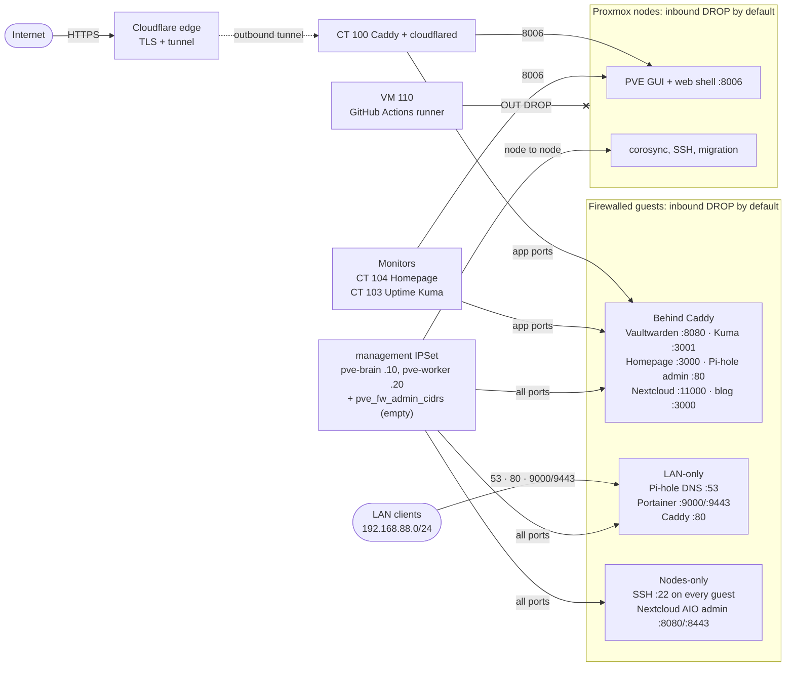

# Proxmox firewall

`roles/pve_firewall` manages the PVE firewall for the cluster, both nodes and every guest that has a `firewall_in` list in `inventory.yml`.

| File | Written by | Content |
|---|---|---|
| `/etc/pve/firewall/cluster.fw` | primary node | `enable`, `policy_in`, aliases (`lan` + one per guest), IPSets `management`, `pve_nodes`, `monitors`, `api_clients`, node rules |
| `/etc/pve/nodes/<node>/host.fw` | each node | `enable`, `nosmurfs`, `tcpflags` |
| `/etc/pve/firewall/<vmid>.fw` | primary node | `policy_in: DROP` + the guest's `firewall_in` / `firewall_out` |

The role also sets `firewall=1` on `net0` of every firewalled guest (rules are ignored without it). New guests get the flag at provision time.

## Diagram

Solid arrows are allowed inbound flows (port in the label). Everything else into a node or firewalled guest is dropped. Return traffic for established connections is always allowed.



| From | To | Ports | Rule source |
|---|---|---|---|
| Cloudflare tunnel → Caddy | each app | its app port, 8006 on pve-brain | `caddy` alias, `api_clients` IPSet |
| Homepage, Uptime Kuma | apps, both nodes | app ports, 8006 | `monitors`, `api_clients` IPSets |
| Any LAN client | Pi-hole / Caddy / Portainer | 53 / 80 / 9000, 9443 | `lan` alias (DNS: any source) |
| Nodes (+ `pve_fw_admin_cidrs`) | nodes, every firewalled guest | 22, 8006, console, all app ports | `management` IPSet |
| Node ↔ node | corosync | UDP 5405-5412 | built in |
| VM 110 | either node | anything (new connections) | `OUT DROP -dest +pve_nodes` |
| Anyone else | node GUI/SSH, Nextcloud AIO admin | — | dropped: admin is tunnel-only via `proxmox.<zone>` |

## Policy

- **Nodes:** default DROP. GUI/SSH/console (22, 8006, 3128, 5900-5999) only from `+management` (both nodes + `pve_fw_admin_cidrs`), built in by PVE. Corosync between nodes is built in. `api_clients` (Caddy, Homepage, Uptime Kuma) may reach 8006.
- **Guests:** default DROP inbound. SSH from `+management`, ping from `lan`, and each app port only from `caddy`, `+monitors` (Homepage, Uptime Kuma) and `+management`. Pi-hole DNS is open to everyone.
- **VM 110** (self-hosted GitHub runner) cannot open connections to the nodes (`OUT DROP -dest +pve_nodes`).
- **k8s VMs 120/130** have no `firewall_in` and stay unfiltered.

## Variables

| Variable | Default | Description |
|---|---|---|
| `pve_fw_enabled` | `true` | Datacenter `enable` |
| `pve_fw_policy_in` | `DROP` | Node default policy; `ACCEPT` for a dry run |
| `pve_fw_admin_cidrs` | `[]` | Extra client IPs for direct access; added to `management`. Empty = tunnel-only |
| `pve_fw_lan_cidr` | `192.168.88.0/24` | `lan` alias |
| `pve_fw_api_clients` | caddy, homepage, uptime-kuma | Guests allowed to 8006 on the nodes |
| `pve_fw_monitors` | homepage, uptime-kuma | Guests allowed to poll app ports |

Guest rule schema (on the host in `inventory.yml`):

```yaml
firewall_in:
  - { dport: 8080, source: [caddy, +monitors, +management], comment: ui }
  - { macro: DNS }                    # macro, any source
  - { dport: "8080,8443", proto: tcp, source: +management }
firewall_out:
  - { dest: +pve_nodes }              # action defaults to DROP
```

## Deploy

With `pve_fw_admin_cidrs` empty (the default), the node GUI and its web shell are reachable only through `proxmox.<zone>` (Cloudflare → Caddy → 8006), and Nextcloud AIO admin (8080/8443) only from the nodes. Portainer (9000/9443) is LAN-only. Add a `/32` temporarily when you need one of those. Safest rollout:

```bash
ansible-playbook playbooks/configure-firewall.yml -e pve_fw_policy_in=ACCEPT
# confirm proxmox.<zone> + its web shell still work, then:
ansible-playbook playbooks/configure-firewall.yml
pve-firewall status
```

Guest rules apply as soon as the NIC flag is set; check every route through Caddy and the Homepage widgets after the first run.

## Lockout recovery

From the node console: `pve-firewall stop`, fix `/etc/pve/firewall/cluster.fw` (or set `enable: 0`), `pve-firewall start`.
